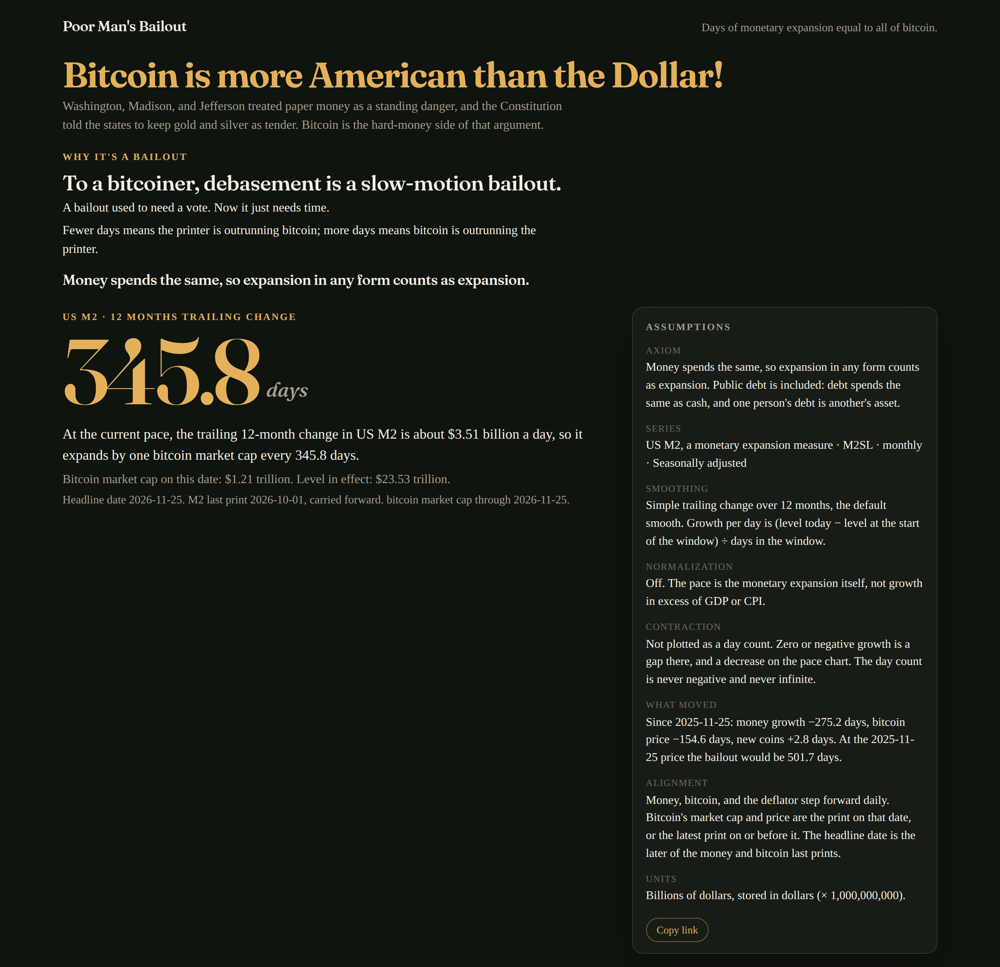

# Poor Man's Bailout

**One path among many.**

Bitcoin is a choice each person can make, or leave alone. It is one possible path among many, not a destination anyone needs to reach. It is not easy: the price is volatile, custody is your own, and there is a real learning curve.

To a bitcoiner, debasement is a slow-motion bailout. That is one way of seeing it, not a call to act. Fewer days means the printer is outrunning bitcoin; more days means bitcoin is outrunning the printer.

How many days of monetary expansion equal the entire bitcoin market cap.

Money spends the same, so expansion in any form counts as expansion. M2, the monetary base, currency in circulation, public debt, and the Fed balance sheet all count. Debt spends the same as cash: one person's debt is another's asset.

**[humdings.github.io/poor-man](https://humdings.github.io/poor-man/)**



On a date *t*, over a window that starts at *s* and spans *N* calendar days:

```
d(t) = C(t) / g(t)     when g(t) > 0
```

*C* is the bitcoin market cap in dollars. *g* is the pace of the chosen measure, in dollars per day. The default is US M2 and a 12-month trailing change, `(M(t) − M(s)) / N`.

## In their words

The page runs these as a scrolling strip and shuffles the order on each visit. Morgan, Saylor, and the IOU stay together, in that order, and the IOU card is set larger. Verbatim, except the cards marked attributed or paraphrase. Film lines are the picture's own words. A one-line frame above a film card is ours. The list below is a catalog, not the order on a given visit.

> And I sincerely believe with you, that banking establishments are more dangerous than standing armies; & that the principle of spending money to be paid by posterity, under the name of funding, is but swindling futurity on a large scale

Thomas Jefferson to John Taylor, 28 May 1816. [Founders Online](https://founders.archives.gov/documents/Jefferson/03-10-02-0053).

> That's not a knife. That's a knife.

The dollar, and a bitcoin. Michael J. "Crocodile" Dundee, *Crocodile Dundee* (1986). [Wikiquote](https://en.wikiquote.org/wiki/Crocodile_Dundee).

> No State shall enter into any Treaty, Alliance, or Confederation; grant Letters of Marque and Reprisal; coin Money; emit Bills of Credit; make any Thing but gold and silver Coin a Tender in Payment of Debts; pass any Bill of Attainder, ex post facto Law, or Law impairing the Obligation of Contracts, or grant any Title of Nobility.

United States Constitution, Article I, Section 10. [National Archives transcript](https://www.archives.gov/founding-docs/constitution-transcript).

> All warfare is based on deception.

Sun Tzu, *The Art of War*, Lionel Giles translation (1910). [Project Gutenberg](https://www.gutenberg.org/files/17405/17405-h/17405-h.htm).

> The loss which America has sustained since the peace, from the pestilent effects of paper money on the necessary confidence between man and man, on the necessary confidence in the public councils, on the industry and morals of the people, and on the character of republican government, constitutes an enormous debt against the States chargeable with this unadvised measure, which must long remain unsatisfied; or rather an accumulation of guilt, which can be expiated no otherwise than by a voluntary sacrifice on the altar of justice, of the power which has been the instrument of it.

James Madison, Federalist No. 44, New York Packet, 25 January 1788. [Avalon Project](https://avalon.law.yale.edu/18th_century/fed44.asp).

> I have a feeling that in a few years people are gonna be doing what they always do when the economy tanks.

Mark Baum, *The Big Short* (2015). The next sentence is left off. [Clip.Cafe](https://clip.cafe/the-big-short-2015/i-have-a-feelingthat-in-a-few-years-people-are-gonna-be-doingwhat-they-always-do-when-the-economy/).

> Paper money has had the effect in your State that it ever will have, to ruin commerce—oppress the honest, and open a door to every species of fraud and injustice.

George Washington to Jabez Bowen, 9 January 1787. [Founders Online](https://founders.archives.gov/documents/Washington/04-04-02-0428).

> The point is, ladies and gentlemen, that greed, for lack of a better word, is good.

Gordon Gekko, *Wall Street* (1987). [Wikiquote](https://en.wikiquote.org/wiki/Wall_Street_(1987_film)).

> Bank-paper must be suppressed, and the circulating medium must be restored to the nation to whom it belongs.

Thomas Jefferson to John Wayles Eppes, 11 September 1813. [Founders Online](https://founders.archives.gov/documents/Jefferson/03-06-02-0388).

> There is no spoon.

Spoon Boy, *The Matrix* (1999). [Wikiquote](https://en.wikiquote.org/wiki/The_Matrix_(film)).

> This law, briefly expressed, is that bad money drives out good money, but that good money cannot drive out bad money.

William Stanley Jevons, *Money and the Mechanism of Exchange* (1875), on the law named for Sir Thomas Gresham. [Econlib](https://www.econlib.org/book-chapters/chapter-chapter-viii-the-principles-of-circulation/).

> Excuse me. I believe you have my stapler.

Milton Waddams, *Office Space* (1999).

> By a continuing process of inflation, governments can confiscate, secretly and unobserved, an important part of the wealth of their citizens.

John Maynard Keynes, *The Economic Consequences of the Peace* (1919). [Wikisource](https://en.wikisource.org/wiki/The_Economic_Consequences_of_the_Peace/Chapter_6).

> There are three ways to make a living in this business: be first, be smarter, or cheat.

John Tuld, *Margin Call* (2011). [Wikiquote](https://en.wikiquote.org/wiki/Margin_Call_(film)).

> The first panacea for a mismanaged nation is inflation of the currency; the second is war. Both bring a temporary prosperity; both bring a permanent ruin. But both are the refuge of political and economic opportunists.

Ernest Hemingway, "Notes on the Next War," *Esquire*, September 1935. [Harper's](https://harpers.org/2007/09/hemingway-on-the-politics-of-war/).

> So you're telling me there's a chance.

Lloyd Christmas, *Dumb and Dumber* (1994). [Clip.Cafe](https://clip.cafe/dumb-dumber-1994/i-want-ask-a-question-straight-out-flat-out/).

> No way. That's great. We landed on the moon!

Lloyd Christmas, *Dumb and Dumber* (1994). [Clip.Cafe](https://clip.cafe/dumb-dumber-1994/no-way/).

> It follows from the propositions I have so far stated that inflation is always and everywhere a monetary phenomenon in the sense that it is and can be produced only by a more rapid increase in the quantity of money than in output.

Milton Friedman, "The Counter-Revolution in Monetary Theory," 16 September 1970. [Hoover Institution](https://miltonfriedman.hoover.org/internal/media/dispatcher/214480/full).

> Are you not entertained?

Maximus, *Gladiator* (2000).

> Inflation is taxation without legislation.

**Attributed to Milton Friedman.** No source in his own words has been found. [MiltonFriedman.org](https://miltonfriedman.org/misattributed).

> Governments will never allow monetary competition, and even bankers do not understand the idea because they have all grown up in the system which is so completely dependent on central banks. So I think we need a roundabout way.

F. A. Hayek, interview with James U. Blanchard III, *Cato Policy Report*, May/June 1984. [Cato Institute](https://web.archive.org/web/20130121123902/https://www.cato.org/policy-report/mayjune-1984/exclusive-interview-fa-hayek).

> I think they've made the biggest financial mess that any government's ever made in this country for a very long time, and Socialist governments traditionally do make a financial mess. They always run out of other people's money. It's quite a characteristic of them.

Margaret Thatcher, Thames TV *This Week*, 5 February 1976. [Thatcher Foundation](https://www.margaretthatcher.org/document/102953).

> Paper money eventually returns to its intrinsic value: zero.

**Attributed to Voltaire.** Widely credited to him. The original source is uncertain.

> Often has it crossed my fancy, that the city loves to deal With the very best and noblest members of her commonwealth, Just as with our ancient coinage, and the newly-minted gold. Yea, for these, our sterling pieces, all of pure Athenian mould, All of perfect die and metal, all the fairest of the fair, All of workmanship unequalled, proved and valued everywhere Both amongst our own Hellenes and Barbarians far away, These we use not: but the worthless pinchbeck coins of yesterday, Vilest die and basest metal, now we always use instead. Even so, our sterling townsmen, nobly born and nobly bred, Men of worth and rank and mettle, men of honourable fame, Trained in every liberal science, choral dance, and manly game, These we treat with scorn and insult, but the strangers newliest come, Worthless sons of worthless fathers, pinchbeck townsmen, yellowy scum, Whom in earlier days the city hardly would have stooped to use Even for her scapegoat victims, these for every task we choose. O unwise and foolish people, yet to mend your ways begin; Use again the good and useful: so hereafter, if ye win ’Twill be due to this your wisdom: if ye fall, at least ’twill be Not a fall that brings dishonour, falling from a worthy tree.

Aristophanes, *The Frogs*, lines 718–737. Benjamin Bickley Rogers, Harvard Classics (1909–14). [Bartleby](https://www.bartleby.com/lit-hub/hc/the-frogs/lines-500-999/).

> Further, the law enjoins that no private man shall be allowed to possess gold and silver, but only coin for daily use, which is almost necessary in dealing with artisans, and for payment of hirelings, whether slaves or immigrants, by all those persons who require the use of them. Wherefore our citizens, as we say, should have a coin passing current among themselves, but not accepted among the rest of mankind;

**the villain's view.** Plato, *Laws*, Book V, 742a–b. Benjamin Jowett. [Internet Classics Archive](http://classics.mit.edu/Plato/laws.5.v.html).

> for the mind converts and changes every hindrance to its activity into an aid; and so that which is a hindrance is made a furtherance to an act; and that which is an obstacle on the road helps us on this road.

**Marcus Aurelius, and all HODLers.** *Meditations* 5.20, translated by George Long (1862). [Internet Classics Archive](http://classics.mit.edu/Antoninus/meditations.5.five.html).

> He that loveth silver shall not be satisfied with silver; nor he that loveth abundance with increase: this is also vanity.

**Ecclesiastes, and 2026 silver holders.** Ecclesiastes 5:10, King James Version. [Bible Gateway](https://www.biblegateway.com/passage/?search=Ecclesiastes+5%3A10&version=KJV).

> A false balance is abomination to the LORD: but a just weight is his delight.

Proverbs 11:1, King James Version. [Bible Gateway](https://www.biblegateway.com/passage/?search=Proverbs+11%3A1&version=KJV).

> Thy silver is become dross, thy wine mixed with water:

Isaiah 1:22, King James Version. [Bible Gateway](https://www.biblegateway.com/passage/?search=Isaiah+1%3A22&version=KJV).

> Divers weights, and divers measures, both of them are alike abomination to the LORD.

Proverbs 20:10, King James Version. [Bible Gateway](https://www.biblegateway.com/passage/?search=Proverbs+20%3A10&version=KJV).

> Saying, When will the new moon be gone, that we may sell corn? and the sabbath, that we may set forth wheat, making the ephah small, and the shekel great, and falsifying the balances by deceit?

Amos 8:5, King James Version. [Bible Gateway](https://www.biblegateway.com/passage/?search=Amos+8%3A5&version=KJV).

> Shall I count them pure with the wicked balances, and with the bag of deceitful weights?

Micah 6:11, King James Version. [Bible Gateway](https://www.biblegateway.com/passage/?search=Micah+6%3A11&version=KJV).

> Ye shall have just balances, and a just ephah, and a just bath.

Ezekiel 45:10, King James Version. [Bible Gateway](https://www.biblegateway.com/passage/?search=Ezekiel+45%3A10&version=KJV).

> Woe to those who give less [than due], Who, when they take a measure from people, take in full. But if they give by measure or by weight to them, they cause loss.

Quran 83:1–3, Saheeh International. [Quran.com](https://quran.com/83/1-3).

> And the heaven He raised and imposed the balance
> That you not transgress within the balance.
> And establish weight in justice and do not make deficient the balance.

Quran 55:7–9, Saheeh International. [Quran.com](https://quran.com/55/7-9).

> And give full measure when you measure, and weigh with an even [i.e., honest] balance. That is the best [way] and best in result.

Quran 17:35, Saheeh International. [Quran.com](https://quran.com/17/35).

> Money is gold, and nothing else.

J. Pierpont Morgan, Money Trust Investigation, 19 December 1912. [FRASER](https://fraser.stlouisfed.org/files/docs/historical/house/money_trust/montru_pt15.pdf). The popular line "Gold is money. Everything else is credit." is a paraphrase.

**Michael Saylor (paraphrase).** No post or checked transcript prints this as one sentence.

> Bitcoin is money, everything else is credit.

> That's as good as money, sir. Those are I.O.U.'s.

Lloyd Christmas, *Dumb and Dumber* (1994). [Clip.Cafe](https://clip.cafe/dumb-dumber-1994/listen-mr-samsonite-about-the-briefcase/).

> You can tell everybody to go fuck themselves. […] the classic Bitcoiner response is, Oh, yeah, my Bitcoin, I lost it in a boating accident. You ever heard that phrase? It's kind of a trope, but what it means is at the end of the day, if you push me too far, I lost it. It's gone. Sorry. Tax that.

Michael Saylor, METAL interview, January 2021. [YouTube](https://www.youtube.com/watch?v=BoVlCnZe5vQ). The bracket skips a clause the captions and the write-ups do not agree on.

> Bitcoin isn’t strictly a monetary protocol.

> Instead, Bitcoin appears to be emerging as a cyber power projection tactic for the digital age.

> While most software can only logically constrain computers, Bitcoin can physically constrain computers and impose severe physical costs (as measured in watts) on belligerent actors in, from, and through cyberspace.

> Bitcoin is proof that proof-of-work works.

> Bitcoin could represent a strategically vital national security technology for the digital age.

Jason Lowery, *Softwar* (MIT, February 2023). [MIT DSpace](https://hdl.handle.net/1721.1/153030).

## Headline

Default view in the snapshot generated **2026-11-26**: 12-month trailing change, normalization off. Headline date **2026-11-25**. Bitcoin market cap that day: **$1.21 trillion**.

The live page replaces this table whenever the nightly job commits a new snapshot.

| Measure | Days | Pace | Level in effect |
| --- | ---: | ---: | --- |
| US M2 | 345.8 | $3.51 billion a day | $23.53 trillion, print 2026-10-01, carried forward |
| Monetary base | 2,799 | $433.15 million a day | $5.46 trillion, print 2026-10-01, carried forward |
| Currency in circulation | 6,958 | $174.25 million a day | $2.49 trillion, print 2026-10-01, carried forward |
| Public debt | 181.9 | $6.66 billion a day | $40.79 trillion, through 2026-11-24 |
| Fed balance sheet | 2,377 | $510.05 million a day | $6.74 trillion, through 2026-11-18 |

The Fed balance sheet is last in the toggle and stays off the comparison strip. It is still monetary expansion.

## Measures

Levels are stored in dollars. No API key.

| Measure | Source | History in this snapshot | Published unit |
| --- | --- | --- | --- |
| US M2, the default | [FRED M2SL](https://fred.stlouisfed.org/series/M2SL) | 1959-01-01 → 2026-10-01 | billions, monthly, seasonally adjusted, × 1e9 |
| Monetary base | [FRED BOGMBASE](https://fred.stlouisfed.org/series/BOGMBASE) | 1959-01-01 → 2026-10-01 | billions, monthly, × 1e9 |
| Currency in circulation | [FRED MBCURRCIR](https://fred.stlouisfed.org/series/MBCURRCIR) | 1959-01-01 → 2026-10-01 | billions, monthly, × 1e9 |
| Public debt | [Debt to the Penny](https://fiscaldata.treasury.gov/datasets/debt-to-the-penny/debt-to-the-penny) `tot_pub_debt_out_amt` | daily from 1993-04-01 → 2026-11-24 | dollars |
| Public debt, earlier history | [FRED GFDEBTN](https://fred.stlouisfed.org/series/GFDEBTN) | 1966-01-01, spliced strictly before 1993-04-01 | millions, quarterly, × 1e6 |
| Fed balance sheet | [FRED WALCL](https://fred.stlouisfed.org/series/WALCL) | 2002-12-18 → 2026-11-18 | millions, Wednesday level, × 1e6 |
| Bitcoin market cap and price | [Coin Metrics](https://docs.coinmetrics.io/api/v4/) `CapMrktCurUSD`, `PriceUSD` | 2010-07-18 → 2026-11-25 | dollars, daily |

M2 is the seasonally adjusted monthly series only. The weekly not-seasonally-adjusted series [WM2NS](https://fred.stlouisfed.org/series/WM2NS) is left out, so the join does not add a seasonal jump. Currency in circulation is MBCURRCIR, the currency component of the monetary base, for the full history that series has.

Optional deflators, used only when normalization is on:

| Deflator | Source | History | What is stored |
| --- | --- | --- | --- |
| Nominal GDP | [FRED GDP](https://fred.stlouisfed.org/series/GDP) | 1947-01-01 → 2026-07-01 | dollars. The series is an annual rate; only the ratio is used, so the annualization cancels |
| CPI | [FRED CPIAUCSL](https://fred.stlouisfed.org/series/CPIAUCSL) | 1947-01-01 → 2026-10-01 | the index, including fractions of a point |

The dollar half-life chart uses that same CPI print. Trailing 12-month inflation is this month's index divided by the index twelve months earlier, minus one. Years to lose half of purchasing power are ln(2) / ln(1 + inflation). At 2% that is 35.0 years. At 7% it is 10.2 years. A rate at or below zero leaves a gap.

If Coin Metrics does not respond, bitcoin falls back to the Blockchain.com market-cap and market-price charts. If the FRED CSV endpoint does not respond, M2, the monetary base, and currency come from the Board's [H.6](https://www.federalreserve.gov/releases/h6/current/default.htm) release, the balance sheet from [H.4.1](https://www.federalreserve.gov/releases/h41/current/), and debt before 1993-04-01 from the Treasury [Historical Debt Outstanding](https://fiscaldata.treasury.gov/datasets/historical-debt-outstanding/historical-debt-outstanding) annual file. `data/series.json` records which path was used.

Each level is stepped forward to every calendar day and held until the next print. Bitcoin's market cap and price on a day are the observations on that day, or the latest on or before it. The headline date is the later of the money print and the bitcoin print.

## Assumptions and options

The panel beside the headline lists the choices in force. The same choices are the query string, so a link is the view:

`?measure=m2&window=12&unit=m&method=trailing&log=1&norm=0`

| Choice | Default | Options |
| --- | --- | --- |
| Series | M2 | Monetary base, currency in circulation, public debt, Fed balance sheet |
| Smoothing | 12 months | None, 3 months, 5 years, 10 years, or a custom number of months or years |
| Averaging | Trailing change | Regression, or CAGR pace. Disabled when smoothing is off |
| Normalization | Off | Excess of nominal GDP, or excess of CPI |
| Fixed bitcoin | Shown under the headline | Days at the window-start price, and at the window-start coin count |
| Contraction | A gap in the day count | The pace chart still draws a decrease |
| Scale | Log on the day-count charts | Linear |

**Smoothing.** The window and the averaging method smooth the pace. Trailing change is `(M(t) − M(s)) / N`. Regression is the ordinary least-squares slope of the daily forward-filled level. CAGR pace is `M(t) × ((M(t) / M(s))^(1/N) − 1)`, the compound rate at today's level. **None** (`window=0`) uses the change between the print in effect and the print before it, held until the next print. A down print stays a decrease.

**Normalization.** Off unless the box is checked. The pace is then money growth in excess of the deflator over the same interval:

```
trailing, and no smoothing
    g* = g − M(s) × (D(t) − D(s)) / (N × D(s))
CAGR
    g* = M(t) × (r(M) − r(D))
regression
    g* = slope(M) − M(t) × slope(ln D)
```

A flat deflator leaves the pace unchanged. If money grew at the same percentage rate as the deflator, the trailing and CAGR excess is zero and the day count pauses.

**Fixed bitcoin.** The change in days since the start of the window splits into three parts that add up: money growth moves first, then the bitcoin price, then coins outstanding. Days at a fixed price hold the price from the start of the window. Days at a fixed coin count hold the number of coins. A longer bailout at a high price is the point: it is a higher valuation relative to monetary expansion.

When the pace is zero or negative, the day count is left blank. A negative or infinite day count is never drawn. The pace chart keeps the decrease, including M2 in 2022–23.

## Run it locally

The day count and the data fetch use the Python standard library. Node is used by the parity tests. The share image uses Pillow, which the nightly job installs. Locally, `python3 -m pip install pillow` before regenerating `data/og.png`.

```bash
python3 -m unittest discover -s tests -v
python3 scripts/fetch_data.py
python3 -m http.server 8000
```

Open `http://127.0.0.1:8000/`. The page reads `data/series.json` and does not call FRED, Treasury, or Coin Metrics itself.

The tests include hand-worked cases for the day count, the split into money growth, bitcoin price, and new coins, excess growth over a deflator, and an unsmoothed decrease, plus JavaScript parity with the Python implementation.

## Nightly data and GitHub Pages

`.github/workflows/pages.yml` does both jobs.

- Every push to `main` runs the tests and deploys the site.
- A schedule at 09:17 UTC, and **Run workflow** by hand, fetch a new `data/series.json`, draw `data/og.png` from it, commit both, and deploy. The data commit deploys again and does not fetch a second time. The PNG is the Open Graph and Twitter card: default M2 days, and the dollar half-life from trailing 12-month CPI. Pillow draws it with the Liberation fonts in `scripts/fonts` (SIL Open Font License). No API key, and the image is a static file.

Before the first deploy, in the repository settings:

1. Pages → Build and deployment → Source: **GitHub Actions**.
2. Actions → General → Workflow permissions: **Read and write**, so the nightly job can commit the snapshot.

The site is [https://humdings.github.io/poor-man/](https://humdings.github.io/poor-man/).

## Tip

Stack sats? Tip the printer-watcher.

[Zap me on Nostr](https://njump.me/npub17z7t6hf6e3xru2lkc79lmkddljnswkn5xz86gppqt7amzvre90kqlew3u8) · Lightning `ivoryfireant9@primal.net` · On-chain `bc1qyut5d3gmlf2lnuntl7aqx3l89sjd6m0ewzs845`

## License

[MIT](LICENSE).
